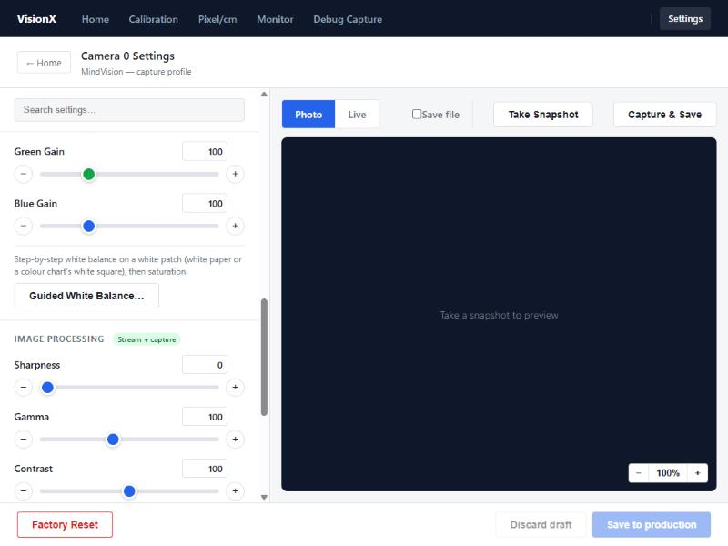
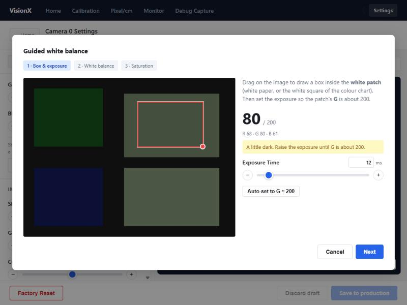
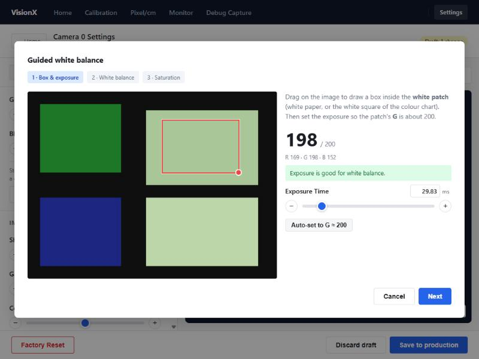
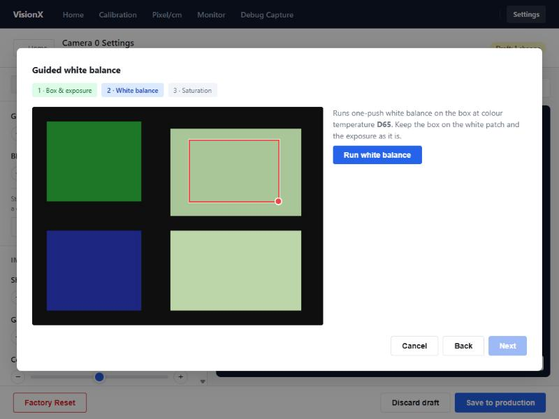
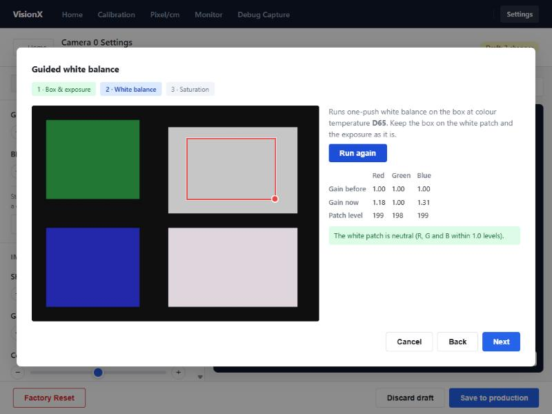
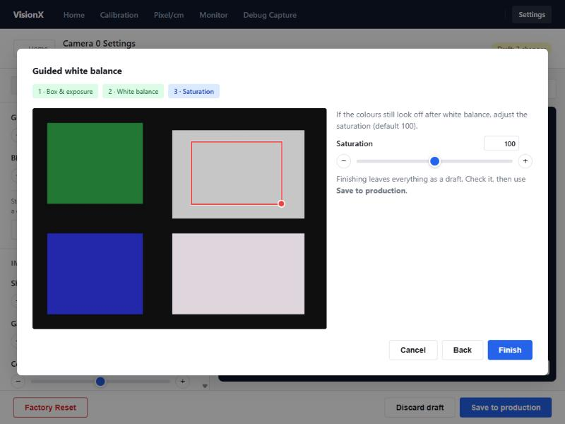
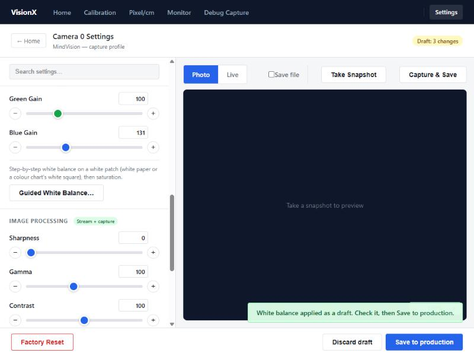

# Guided white balance: operator guide

Use this when the colours in a capture look tinted (a white or grey object is not white or grey), or after you change the lights, the lens aperture or the camera position.

It takes about two minutes. You need a **white patch** in the camera's view: a sheet of plain white paper, or the white square of a colour chart. It does not have to fill the picture, only a part of it.

## Before you start

- Switch the lights on and let them settle (a minute for most lights).
- Put the white patch in view, flat and evenly lit. No shadows or glare on it.
- Do the white balance with the **same lights and the same lens aperture** you will capture with. If either changes later, run it again.
- The camera must not be in hardware-trigger mode (the wizard says so if it is).

> The screenshots below were taken against a simulated camera, so the picture is a test scene. The buttons, numbers and messages are what you will see.

## Steps

1. Open the camera's settings page and find **Gain & White Balance**. Press **Guided White Balance…**.

   

2. **Step 1: Box & exposure**
   - **Draw the box.** Drag on the image to draw a box **inside** the white patch. Keep it well away from the patch's edges and from anything that is not white. You can drag the box to move it, or drag its round corner handle to resize it.
   

   - **Set the exposure.** Look at the big **G** number. It should be **about 200**. Either press **Auto-set to G ≈ 200**, or move the exposure slider yourself.
   - The message under the number tells you what to do:

     | Message | Meaning |
     | ------- | ------- |
     | Green: "Exposure is good" | G is 185 to 215. Go on. |
     | Yellow: "A little dark / bright" | Close enough to continue, but adjusting is better. |
     | Red: "too dark" | Raise the exposure, or check the box is on the white patch. *Next* is blocked. |
     | Red: "too bright (clipping)" | Lower the exposure. *Next* is blocked. |

   

   - Press **Next**.

3. **Step 2: White balance**
   

   - Press **Run white balance**. It takes a few seconds. The camera balances on the box at colour temperature D65.
   - Read the result:
     - **Green "The white patch is neutral"**: done. The patch levels (R, G, B) are almost the same.
     - **Yellow "still tinted"**: the box was probably not fully on the white patch, or the light is uneven. Press **Back**, redraw the box, and run it again.
   

   - Press **Next**.

4. **Step 3: Saturation** (optional)
   - If the colours still look off (too dull or too strong), move the saturation slider. The default is 100. The image updates as you move it. If the colours look fine, leave it.
   - Press **Finish**.

   

5. **Save.** The settings are only a **draft** until you press **Save to production** at the bottom of the page. A yellow **Draft** badge at the top shows the changes. Check a capture first if you like (**Take Snapshot**). To undo, press **Discard draft**.

   

**Cancel** at any point puts back everything the wizard changed (exposure, gains, saturation, colour temperature).

## Good to know

- The wizard changes the **capture exposure** to manual so the white balance stays valid. The exposure you finish with is the one saved.
- The result is only correct for the light it was made under. New lights, a different aperture, or a different camera position means running it again.
- Use one white patch and one camera at a time. Each camera has its own white balance.

## If something goes wrong

| What you see | What to do |
| ------------ | ---------- |
| **"Failed to fetch"** (or the page does nothing) | The browser can't reach the app. Check the computer the camera is plugged into is on and the app is running, reload the page, and check you are using the right address. If it started right after an update, the update may not be installed there yet, or the app needs a restart. |
| "No D65 colour-temperature preset" | This camera model does not offer D65. Tell the person who maintains the system. |
| "White balance not applicable to monochrome cameras" | Turn off Monochrome in the settings first. |
| "Settings can't be tested while in hardware-trigger mode" | Take the camera out of hardware-trigger mode on the main page, then try again. |
| "Box is too small" | Draw a larger box inside the white patch. |
| G will not reach 200 | The message says if the exposure is already at its limit. Add light, open the aperture, or (if too bright) reduce the light. |
| Still tinted after two tries | Make sure the patch really is white (not grey-blue or yellowed paper), is evenly lit, and the box is fully inside it. |
